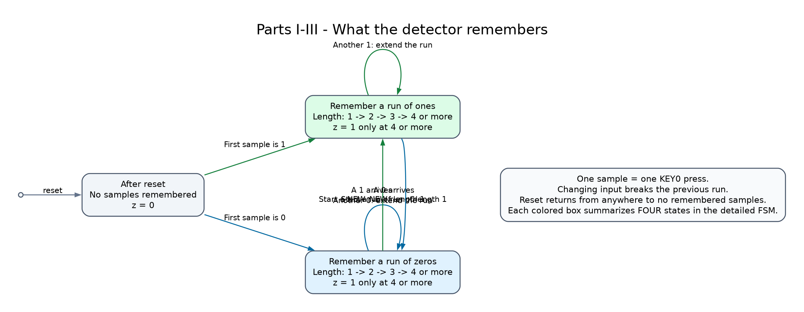

# Week 5 visual guide

Start with this overview. Parts I–III all detect four consecutive zeros or four consecutive ones. A change of input starts a new run of length one.

## Part I: one-hot state machine

Each circle describes what has been remembered so far. Follow one arrow per KEY0 press. Blue arrows mean input 0; green arrows mean input 1. The bottom line is the stored state code. Amber states turn on LEDR9.

## Part I: modified one-hot

The behavior is identical. Only the stored codes change: reset is all zeros, and bit 0 is inverted compared with the original encoding.

## Part II: binary state machine

The same states and arrows are represented using four state bits instead of nine. Changing the encoding changes how the circuit stores its memory, while preserving the intended detection behavior.

For these three FSM versions, SW0 = 0 returns any state to A on the next KEY0 press. Normal input transitions apply when SW0 = 1.

## Part III: shift-register detector

Two four-bit registers remember recent matches. One shifts in a 1 for each zero input, and the other shifts in a 1 for each one input. Four match bits turn on detection. This diagram shows the register implementation rather than a named-state FSM.

## Part IV: Morse encoder

IDLE waits for a new start press. PULSE turns the LED on for a dot or dash. GAP turns it off for half a second between symbols. After the last symbol, the machine returns to IDLE. KEY0 resets from any state immediately.

For A (`.-`), the path is IDLE → PULSE for 0.5 seconds → GAP for 0.5 seconds → PULSE for 1.5 seconds → IDLE.

The PNG images can be opened directly. Editable Graphviz sources are in `diagrams/source/`. The [walkthrough](WALKTHROUGH.md) connects these diagrams to the exact solution code.
