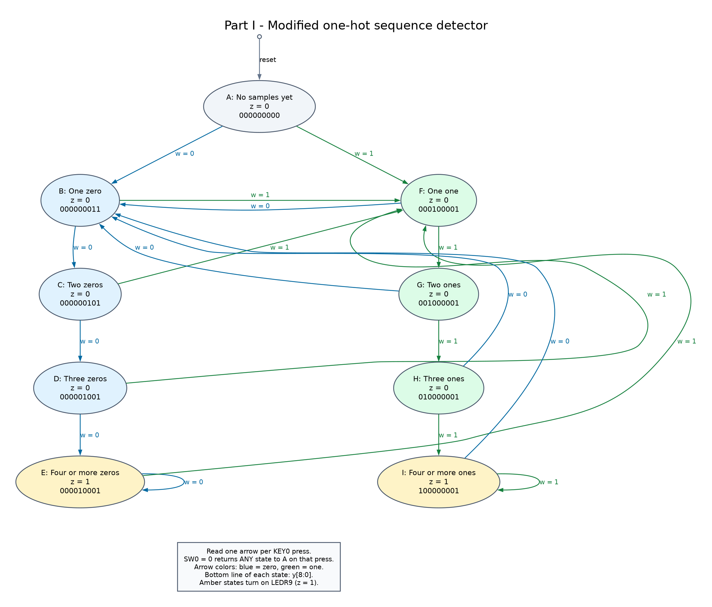
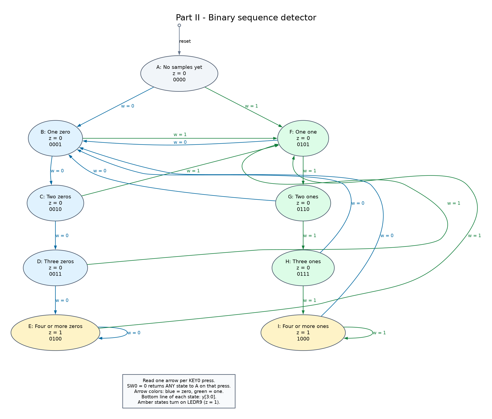
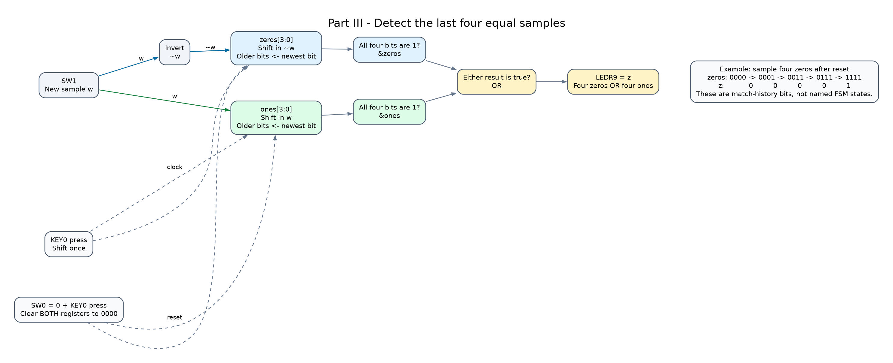
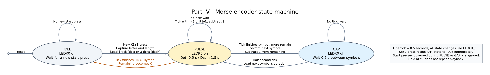

# Week 5 — Finite State Machines

Solutions to all four parts of [the Week 5 lab sheet](../../../lectures/week5/week5_lab_fsm_verilog.pdf), including Part I's modified state encoding. The target is the DE1-SoC and Quartus Prime 18.1.

Start with the [visual guide](DIAGRAMS.md) to see the states and transitions before reading the HDL. Every `.v` file contains code only, with no comments. The five solution listings below contain the same code with comments added. Compile the `.v` files in Quartus; the Markdown listings are for learning.

| Lab section | HDL file | Quartus project | Top-level entity |
|---|---|---|---|
| Part I: original one-hot | [part1.v](../rtl/part1.v) | [part1.qpf](../quartus/part1.qpf) | `week5_part1` |
| Part I: modified one-hot | [part1_modified.v](../rtl/part1_modified.v) | [part1_modified.qpf](../quartus/part1_modified.qpf) | `week5_part1_modified` |
| Part II: binary FSM | [part2.v](../rtl/part2.v) | [part2.qpf](../quartus/part2.qpf) | `week5_part2` |
| Part III: two shift registers | [part3.v](../rtl/part3.v) | [part3.qpf](../quartus/part3.qpf) | `week5_part3` |
| Part IV: Morse encoder | [part4.v](../rtl/part4.v) | [part4.qpf](../quartus/part4.qpf) | `week5_part4` |

Each solution is a complete board top-level module. It needs only its own HDL file. The two testbenches are simulation files and are excluded from the Quartus projects.

## Parts I–III: behavior and board controls

The circuit samples `w` once per clock edge. After four consecutive equal samples, `z` becomes 1. Further equal samples keep `z` at 1; the first opposite sample makes it 0. This implements overlapping detection.

| Board control | Meaning |
|---|---|
| SW0 = 0 | Assert synchronous reset |
| SW0 = 1 | Run normally |
| SW1 | Input `w` |
| KEY0 press | Sample `w` or apply reset |
| LEDR9 | Detection output `z` |

The DE1-SoC buttons are active-low. `clk = ~KEY[0]` makes a press the rising edge. Release does not take another sample. Set SW1 before pressing KEY0.

To reset, set SW0 to 0, press and release KEY0, then return SW0 to 1. SW0 alone does not immediately clear the state because reset is synchronous. The reset edge does not count as an input sample. Apply this reset before testing a sequence.

For example, after reset, the samples `0 0 0 0 0 1 1 1 1` produce `z = 0 0 0 1 1 0 0 0 1`.

## Part I: one-hot FSM


The state records the current run of zeros or ones. `E` and `I` represent runs of at least four samples. A Moore output depends on the stored state, so `z` is high precisely in those two states.

| State | Meaning | If `w = 0`, next state | If `w = 1`, next state | `z` | Original `y[8:0]` |
|---|---|---|---|---|---|
| A | Reset; no samples yet | B | F | 0 | 000000001 |
| B | One zero | C | F | 0 | 000000010 |
| C | Two zeros | D | F | 0 | 000000100 |
| D | Three zeros | E | F | 0 | 000001000 |
| E | At least four zeros | E | F | 1 | 000010000 |
| F | One one | B | G | 0 | 000100000 |
| G | Two ones | B | H | 0 | 001000000 |
| H | Three ones | B | I | 0 | 010000000 |
| I | At least four ones | B | I | 1 | 100000000 |

One-hot means exactly one state bit is 1 in each valid state. `y[0]` represents A, `y[1]` represents B, and so on. A nine-bit `reg` updated by `always @(posedge clk)` describes nine flip-flops. The corresponding nine-bit wire `d` describes their input connections.

Derive each equation by finding every arrow entering that state. For example, C can only be entered from B with `w = 0`, giving `d[2] = reset_n & ~w & y[1]`. E can be entered from D or remain in E with `w = 0`, giving `d[4] = reset_n & ~w & (y[3] | y[4])`.

B is entered from A or any of the one-run states when the input is 0. F is entered from A or any of the zero-run states when the input is 1. Those are the longer OR expressions.

When `reset_n = 0`, `d[0]` becomes 1 and every other `d` bit becomes 0. These values enter the flip-flops at the next rising edge. No `case` or procedural `if` is used for the next-state logic, as required by Part I.

### Commented version of part1.v

```verilog
module week5_part1 (
    // KEY0 is the manual clock input; a one-bit vector keeps the board name KEY[0].
    input [0:0] KEY,
    // SW0 is active-low reset; SW1 is the sampled input w.
    input [1:0] SW,
    output [9:0] LEDR
);
    wire clk;
    wire reset_n;
    wire w;
    // The d wires carry the next values to the nine flip-flop inputs.
    wire [8:0] d;
    // Nine flip-flops store the state; bit 0 represents A in the original encoding.
    reg [8:0] y;

    // KEY0 is low when pressed, so inversion creates a rising edge on a press.
    assign clk = ~KEY[0];
    // The _n name indicates that zero asserts reset.
    assign reset_n = SW[0];
    // Connect the input switch directly to w.
    assign w = SW[1];

    // Enter A on a reset edge; normal operation leaves A.
    assign d[0] = ~reset_n;
    // Enter B on zero from A or any of the one-run states.
    assign d[1] = reset_n & ~w & (y[0] | y[5] | y[6] | y[7] | y[8]);
    // B plus zero gives C: two consecutive zeros.
    assign d[2] = reset_n & ~w & y[1];
    // C plus zero gives D: three consecutive zeros.
    assign d[3] = reset_n & ~w & y[2];
    // D plus zero enters E; E plus zero stays in E for overlapping matches.
    assign d[4] = reset_n & ~w & (y[3] | y[4]);
    // Enter F on one from A or any of the zero-run states.
    assign d[5] = reset_n & w & (y[0] | y[1] | y[2] | y[3] | y[4]);
    // F plus one gives G: two consecutive ones.
    assign d[6] = reset_n & w & y[5];
    // G plus one gives H: three consecutive ones.
    assign d[7] = reset_n & w & y[6];
    // H plus one enters I; I plus one stays in I for overlapping matches.
    assign d[8] = reset_n & w & (y[7] | y[8]);

    // Stored state changes only on a rising edge; use nonblocking assignments.
    always @(posedge clk) begin
        y <= d;
    end

    // Expose all nine state bits on the board LEDs.
    assign LEDR[8:0] = y;
    // E or I means at least four equal samples, so turn on z.
    assign LEDR[9] = y[4] | y[8];
endmodule
```

LEDR8–0 show the state bits directly. After reset LEDR0 is on. Four zeros move the lit state LED through LEDR1, LEDR2, LEDR3, and LEDR4; at LEDR4, LEDR9 also turns on. Four ones instead move through LEDR5, LEDR6, LEDR7, and LEDR8.

### Modified one-hot encoding




Part I also asks for A to be all zeros. Invert the meaning of `y[0]` while keeping the other eight bits unchanged. After reset, `y[0] = 0`; after the first non-reset edge, `y[0] = 1` and remains 1 until reset. Therefore the condition for A becomes `~y[0]`.

Only three equations change: `d[0]` becomes `reset_n`, and the references to A in `d[1]` and `d[5]` become `~y[0]`. Detection and transitions remain identical.

| State | Modified `y[8:0]` |
|---|---|
| A | 000000000 |
| B | 000000011 |
| C | 000000101 |
| D | 000001001 |
| E | 000010001 |
| F | 000100001 |
| G | 001000001 |
| H | 010000001 |
| I | 100000001 |

These are exactly the lab's Table 2 codes. Non-reset states have two high bits, because the original A bit has been inverted.

### Commented version of part1_modified.v

```verilog
module week5_part1_modified (
    // KEY0 is the manual clock input; a one-bit vector keeps the board name KEY[0].
    input [0:0] KEY,
    // SW0 is active-low reset; SW1 is the sampled input w.
    input [1:0] SW,
    output [9:0] LEDR
);
    wire clk;
    wire reset_n;
    wire w;
    // The d wires carry the next values to the nine flip-flop inputs.
    wire [8:0] d;
    // Nine state flip-flops; in this version bit 0 is the inverse of the original A bit.
    reg [8:0] y;

    // KEY0 is low when pressed, so inversion creates a rising edge on a press.
    assign clk = ~KEY[0];
    // The _n name indicates that zero asserts reset.
    assign reset_n = SW[0];
    // Connect the input switch directly to w.
    assign w = SW[1];

    // Reset makes bit 0 zero; every normal edge makes it one.
    assign d[0] = reset_n;
    // The A condition is now ~y[0]; all other incoming B conditions are unchanged.
    assign d[1] = reset_n & ~w & (~y[0] | y[5] | y[6] | y[7] | y[8]);
    // B plus zero gives C: two consecutive zeros.
    assign d[2] = reset_n & ~w & y[1];
    // C plus zero gives D: three consecutive zeros.
    assign d[3] = reset_n & ~w & y[2];
    // D plus zero enters E; E plus zero stays in E for overlapping matches.
    assign d[4] = reset_n & ~w & (y[3] | y[4]);
    // Use ~y[0] for A here too; this is the third and final equation change.
    assign d[5] = reset_n & w & (~y[0] | y[1] | y[2] | y[3] | y[4]);
    // F plus one gives G: two consecutive ones.
    assign d[6] = reset_n & w & y[5];
    // G plus one gives H: three consecutive ones.
    assign d[7] = reset_n & w & y[6];
    // H plus one enters I; I plus one stays in I for overlapping matches.
    assign d[8] = reset_n & w & (y[7] | y[8]);

    // Stored state changes only on a rising edge; use nonblocking assignments.
    always @(posedge clk) begin
        y <= d;
    end

    // Expose all nine state bits on the board LEDs.
    assign LEDR[8:0] = y;
    // E or I means at least four equal samples, so turn on z.
    assign LEDR[9] = y[4] | y[8];
endmodule
```

## Part II: binary FSM with case




The same nine states fit into four flip-flops because four bits can encode sixteen values. The lab assigns A through I to binary values 0 through 8.

`y_Q` is the current state stored in flip-flops. `Y_D` is the next state computed by combinational logic. The `case` table implements the transitions above; each ternary expression describes a multiplexer selecting the next state according to `w`.

Use blocking assignments (`=`) inside `always @(*)`: this block computes combinational outputs. Use nonblocking assignments (`<=`) inside the clocked block: this block updates stored state. `reg` alone does not imply a flip-flop; the kind of `always` block determines the hardware.

Every `case` branch assigns `Y_D`, including `default`, so no latch is needed. The lab's incomplete skeleton uses an unknown value for `default`. This solution chooses A for an invalid state, defining a return to A on the next non-reset edge in RTL simulation. Quartus fault recovery after optimization has not been verified; a `default` branch alone is not a guarantee of a synthesized safe-state machine.

### Commented version of part2.v

```verilog
module week5_part2 (
    // KEY0 is the manual clock input; a one-bit vector keeps the board name KEY[0].
    input [0:0] KEY,
    // SW0 is active-low reset; SW1 is the sampled input w.
    input [1:0] SW,
    output [9:0] LEDR
);
    // The fixed four-bit constants use the lab Table 3 binary state assignment.
    localparam [3:0] A = 4'b0000;
    localparam [3:0] B = 4'b0001;
    localparam [3:0] C = 4'b0010;
    localparam [3:0] D = 4'b0011;
    localparam [3:0] E = 4'b0100;
    localparam [3:0] F = 4'b0101;
    localparam [3:0] G = 4'b0110;
    localparam [3:0] H = 4'b0111;
    localparam [3:0] I = 4'b1000;

    wire clk;
    wire reset_n;
    wire w;
    wire z;
    // Current state: four flip-flops updated by the clocked block.
    reg [3:0] y_Q;
    // Next state: a combinational result, despite being declared reg.
    reg [3:0] Y_D;

    // KEY0 is low when pressed, so inversion creates a rising edge on a press.
    assign clk = ~KEY[0];
    // The _n name indicates that zero asserts reset.
    assign reset_n = SW[0];
    // Connect the input switch directly to w.
    assign w = SW[1];

    // Recompute next state whenever its inputs change; use blocking assignments.
    always @(*) begin
        // Each row selects the next state for the current stored state.
        case (y_Q)
            A: Y_D = w ? F : B;
            B: Y_D = w ? F : C;
            C: Y_D = w ? F : D;
            D: Y_D = w ? F : E;
            // Another zero keeps the detected zero run; a one starts a new one run.
            E: Y_D = w ? F : E;
            F: Y_D = w ? G : B;
            G: Y_D = w ? H : B;
            H: Y_D = w ? I : B;
            // Another one keeps the detected one run; a zero starts a new zero run.
            I: Y_D = w ? I : B;
            // Assign every path and define RTL recovery for unused state values.
            default: Y_D = A;
        endcase
    end

    // Stored state changes only on a rising edge; use nonblocking assignments.
    always @(posedge clk) begin
        // Synchronous reset has priority over the next-state table.
        if (!reset_n)
            y_Q <= A;
        else
            y_Q <= Y_D;
    end

    // Two equality comparators and an OR decode the Moore output.
    assign z = (y_Q == E) | (y_Q == I);
    // LEDR9 shows detection, LEDR8-4 are off, LEDR3-0 show the state.
    assign LEDR = {z, 5'b00000, y_Q};
endmodule
```

LEDR3–0 show the four-bit current state. LEDR8–4 are off. LEDR9 still shows `z`.

### Required Quartus encoding comparison

The supplied Part II project includes:

```tcl
set_global_assignment -name STATE_MACHINE_PROCESSING "USER-ENCODED"
```

This requests the state assignment in the HDL. The [Intel settings reference](https://www.intel.com/programmable/technical-pdfs/683296.pdf) documents `STATE_MACHINE_PROCESSING` and the User-Encoded and One-Hot choices.

1. Compile `part2.qpf` with User-Encoded selected.
2. Open **Tools → Netlist Viewers → RTL Viewer**, find the FSM, and inspect its transition diagram.
3. In **Compilation Report → Analysis & Synthesis → State Machines**, record the encodings actually used. The requested binary values are A=0000 through I=1000.
4. In **Assignments → Settings → Compiler Settings → Advanced Settings (Synthesis)**, change **State Machine Processing** to **One-Hot**. Recompile and inspect the state report again.
5. Compare the new encodings with Table 2. Quartus may choose a different bit order or reset-state representation. Equivalent encodings can implement the same state transitions and `z` behavior.
6. Restore User-Encoded for the supplied binary project when finished.

The actual automatically selected codes must come from your compilation report. They have not been measured here. Physical state bits after recoding can differ from the source-level values displayed by LEDR3–0; use the report to inspect internal encoding.

## Part III: two shift registers




`ones` shifts in `w`. `zeros` shifts in `~w`. Thus a 1 in either register means the corresponding sample matched the kind of run that register detects.

`{ones[2:0], w}` discards the oldest bit, moves the other three bits toward bit 3, and inserts the new sample at bit 0. Both registers are four flip-flops with these connections.

`&ones` is a reduction AND: it becomes 1 only when all four bits are 1. `&zeros` works the same way. OR the two results to detect either sequence.

Both registers reset to zero. These initial zeros represent unmatched history, so neither detector fires before four real matching samples have arrived. For four zeros, `zeros` progresses through `0001`, `0011`, `0111`, and `1111`.

### Commented version of part3.v

```verilog
module week5_part3 (
    // KEY0 is the manual clock input; a one-bit vector keeps the board name KEY[0].
    input [0:0] KEY,
    // SW0 is active-low reset; SW1 is the sampled input w.
    input [1:0] SW,
    output [9:0] LEDR
);
    wire clk;
    wire reset_n;
    wire w;
    wire z;
    // This four-flip-flop register stores whether each recent input was zero.
    reg [3:0] zeros;
    // This four-flip-flop register stores whether each recent input was one.
    reg [3:0] ones;

    // KEY0 is low when pressed, so inversion creates a rising edge on a press.
    assign clk = ~KEY[0];
    // The _n name indicates that zero asserts reset.
    assign reset_n = SW[0];
    // Connect the input switch directly to w.
    assign w = SW[1];

    // Stored state changes only on a rising edge; use nonblocking assignments.
    always @(posedge clk) begin
        // Reset both match histories to zero, so neither can signal a premature match.
        if (!reset_n) begin
            zeros <= 4'b0000;
            ones <= 4'b0000;
        end else begin
            // Shift in one when the new sample is zero; the oldest sample is discarded.
            zeros <= {zeros[2:0], ~w};
            // Shift in one when the new sample is one.
            ones <= {ones[2:0], w};
        end
    end

    // Each reduction AND tests four matching samples; OR detects either run.
    assign z = (&zeros) | (&ones);
    // Display the two histories and z; LEDR8 is off.
    assign LEDR = {z, 1'b0, ones, zeros};
endmodule
```

| LEDs | Meaning |
|---|---|
| LEDR3–0 | `zeros`: latest sample at bit 0 |
| LEDR7–4 | `ones`: latest sample at bit 4 |
| LEDR8 | Off |
| LEDR9 | Four consecutive equal samples detected |

### Could one four-bit shift register be used?

Yes. Store the last four values of `w` in one `history` register. Once four valid samples have arrived, detect all ones with `&history` and all zeros with `~|history` (reduction NOR).

Reset handling needs extra care. If `history` resets to `0000`, the all-zero test is already true before any sample. A mixed reset pattern delays that problem, but after three equal inputs its last remaining initial bit can still complete a false match for one of the two values.

Use a separate three-bit count that resets to 0, increments on each non-reset sample, and saturates at 4. Then gate detection with `valid_count == 3'd4`:

```verilog
assign z = (valid_count == 3'd4) & ((&history) | (~|history));
```

This answers the lab's question while preserving correct behavior immediately after reset. The submitted Part III design uses the requested two shift registers.

## Part IV: Morse-code encoder




Part IV uses the board oscillator, not a manually pressed clock, because pulse widths must be measured in seconds.

| Signal | Purpose |
|---|---|
| CLOCK_50 | 50 MHz clock |
| SW2–0 | Letter selection, 000=A through 111=H |
| KEY1 press | Start the selected letter while idle |
| KEY0 press | Active-low asynchronous reset |
| LEDR0 | Morse pulse output |
| LEDR9–1 | Off |

The board clock and pin mapping follow the Terasic DE1-SoC manual, including CLOCK_50 at AF14; see the [Terasic-authored manual hosted by Cornell](https://people.ece.cornell.edu/land/courses/ece5760/DE1_SOC/DE1-SoC_User_manualv.1.2.2_revE.pdf), Table 3-5. Existing Week 4 KEY, SW, and LEDR assignments are reused. Check the supplied device and pins against your course board package and revision before programming; [Terasic provides revision-specific resources](https://download.terasic.com/downloads/cd-rom/de1-soc/).

### Letter encoding

The four-bit `code` register uses 0 for a dot and 1 for a dash. The next symbol is at bit 3. Padding is on the right and is ignored using the separate length counter.

| SW2–0 | Letter | Morse | Loaded `code[3:0]` | Loaded `remaining` |
|---|---|---|---|---|
| 000 | A | .- | 0100 | 2 |
| 001 | B | -... | 1000 | 4 |
| 010 | C | -.-. | 1010 | 4 |
| 011 | D | -.. | 1000 | 3 |
| 100 | E | . | 0000 | 1 |
| 101 | F | ..-. | 0010 | 4 |
| 110 | G | --. | 1100 | 3 |
| 111 | H | .... | 0000 | 4 |

B and D share the same padded bits but have different lengths. E and H do too. The length counter prevents padding from being transmitted as extra dots.

### Timing and state transitions

At 50 MHz, a half-second is `50,000,000 × 0.5 = 25,000,000` clock cycles. The timer counts from 0 through 24,999,999, then emits a one-cycle enable condition and wraps to 0. It needs 25 bits because `2^24 < 25,000,000 < 2^25`.

The FSM uses three states:

```mermaid
stateDiagram-v2
    [*] --> IDLE: reset
    IDLE --> PULSE: start press; load letter
    PULSE --> PULSE: half-second tick; pulse still needs time
    PULSE --> GAP: symbol finished; more symbols remain
    GAP --> PULSE: half-second tick; start next symbol
    PULSE --> IDLE: final symbol finished
```



In PULSE, LEDR0 is on. `pulse_ticks` starts at 1 for a dot or 3 for a dash. Every half-second tick consumes one unit, giving exactly 0.5 seconds or 1.5 seconds of light.

At the end of a symbol, the circuit shifts `code` left and decrements `remaining`. If another symbol remains, GAP keeps the LED off for one half-second. Otherwise the FSM returns to IDLE and the LED stays off. The sheet specifies pulse lengths but does not specify the gap; this solution chooses a 0.5-second gap between symbols. A new press is needed for another letter.

All state changes use CLOCK_50. The half-second tick is an enable condition, not a second generated clock.

### Button and switch handling

KEY1 passes through two flip-flops before the FSM uses it. A third register retains its previous synchronized value, so `start_previous & ~start_sync` creates a one-cycle press event. Holding KEY1 does not repeatedly start the letter. Press events observed while busy are ignored rather than queued.

The switches also pass through two registers. Set the switches before pressing KEY1 and keep them stable while the letter is captured. Synchronizing each switch bit does not make a changing multi-bit value an atomic transfer. Once playback begins, the pattern and length are stored, so later switch changes do not alter that letter.

`always @(posedge CLOCK_50 or negedge reset_n)` gives KEY0 asynchronous reset: pressing it turns the LED off and clears the transmission without waiting for a clock edge. Release KEY1 before releasing reset for a clean idle start. A KEY1 held low through reset release can be seen as a new press after synchronization.

The parameter `HALF_SECOND_CYCLES` defaults to 25,000,000 for hardware. The testbench overrides it with small values to test complete letters quickly. Keep the default in the Quartus project. With the fixed 25-bit counter, supported parameter values are 1 through 33,554,431 cycles.

### Commented version of part4.v

```verilog
module week5_part4 #(
    // At 50 MHz this many cycles take 0.5 seconds; simulation overrides it.
    parameter [24:0] HALF_SECOND_CYCLES = 25'd25000000
) (
    input CLOCK_50,
    input [1:0] KEY,
    input [2:0] SW,
    output [9:0] LEDR
);
    // Three FSM states: wait for start, illuminate a symbol, and wait between symbols.
    localparam [1:0] IDLE = 2'd0;
    localparam [1:0] PULSE = 2'd1;
    localparam [1:0] GAP = 2'd2;

    wire reset_n;
    wire start_press;
    wire half_second_tick;
    reg start_meta;
    reg start_sync;
    reg start_previous;
    reg [2:0] letter_meta;
    reg [2:0] letter_sync;
    reg [3:0] selected_code;
    reg [2:0] selected_length;
    reg [1:0] state;
    // A 25-bit counter measures one half-second at the hardware setting.
    reg [24:0] timer;
    // Stored Morse symbols: bit 3 is next; 0 is dot and 1 is dash.
    reg [3:0] code;
    // Number of symbols still to transmit, including the current one.
    reg [2:0] remaining;
    // Half-second units still needed for the current pulse: 1 for dot, 3 for dash.
    reg [1:0] pulse_ticks;

    // KEY0 is already active-low and resets the encoder asynchronously.
    assign reset_n = KEY[0];
    // Detect a high-to-low change in the synchronized start button.
    assign start_press = start_previous & ~start_sync;
    // Terminal-count comparison; counting from zero requires subtracting one.
    assign half_second_tick = (timer == HALF_SECOND_CYCLES - 25'd1);

    always @(posedge CLOCK_50 or negedge reset_n) begin
        if (!reset_n) begin
            start_meta <= 1'b1;
            start_sync <= 1'b1;
            start_previous <= 1'b1;
            letter_meta <= 3'd0;
            letter_sync <= 3'd0;
        end else begin
            // First stage samples the external button.
            start_meta <= KEY[1];
            // Second stage supplies the button value used by the FSM.
            start_sync <= start_meta;
            // Remember the previous synchronized value for press detection.
            start_previous <= start_sync;
            // First stage samples the switches; select a stable value before pressing start.
            letter_meta <= SW;
            // Second stage supplies the stable letter selection.
            letter_sync <= letter_meta;
        end
    end

    // Combinational lookup table produces a pattern and its useful symbol count.
    always @(*) begin
        // Codes are left-aligned; trailing zeros are padding, not extra dots.
        case (letter_sync)
            3'd0: begin selected_code = 4'b0100; selected_length = 3'd2; end
            3'd1: begin selected_code = 4'b1000; selected_length = 3'd4; end
            3'd2: begin selected_code = 4'b1010; selected_length = 3'd4; end
            3'd3: begin selected_code = 4'b1000; selected_length = 3'd3; end
            3'd4: begin selected_code = 4'b0000; selected_length = 3'd1; end
            3'd5: begin selected_code = 4'b0010; selected_length = 3'd4; end
            3'd6: begin selected_code = 4'b1100; selected_length = 3'd3; end
            3'd7: begin selected_code = 4'b0000; selected_length = 3'd4; end
            default: begin selected_code = 4'b0000; selected_length = 3'd1; end
        endcase
    end

    always @(posedge CLOCK_50 or negedge reset_n) begin
        if (!reset_n)
            timer <= 25'd0;
        // Keep the timer at zero while idle and wrap it on each half-second tick.
        else if (state == IDLE || half_second_tick)
            timer <= 25'd0;
        else
            timer <= timer + 25'd1;
    end

    always @(posedge CLOCK_50 or negedge reset_n) begin
        if (!reset_n) begin
            state <= IDLE;
            code <= 4'b0000;
            remaining <= 3'd0;
            pulse_ticks <= 2'd0;
        end else begin
            // The clocked FSM also controls loading, shifting, and the symbol counters.
            case (state)
                IDLE: begin
                    // Accept a new letter only while idle.
                    if (start_press) begin
                        // Capture the pattern so later switch changes cannot alter playback.
                        code <= selected_code;
                        // Capture the length to distinguish letters with the same padded pattern.
                        remaining <= selected_length;
                        // Choose 1.5 seconds for a dash or 0.5 seconds for a dot.
                        pulse_ticks <= selected_code[3] ? 2'd3 : 2'd1;
                        state <= PULSE;
                    end
                end
                PULSE: begin
                    if (half_second_tick) begin
                        // This tick completes the current symbol.
                        if (pulse_ticks == 2'd1) begin
                            // Move the next symbol into bit 3.
                            code <= {code[2:0], 1'b0};
                            // Consume one symbol.
                            remaining <= remaining - 3'd1;
                            // Test the old count: one means this was the final symbol.
                            state <= (remaining == 3'd1) ? IDLE : GAP;
                        end else begin
                            // A dash needs three ticks, so keep the LED on until all are consumed.
                            pulse_ticks <= pulse_ticks - 2'd1;
                        end
                    end
                end
                // The LED is off in GAP; one half-second tick starts the next symbol.
                GAP: begin
                    if (half_second_tick) begin
                        // Use the shifted pattern to load the duration of the next symbol.
                        pulse_ticks <= code[3] ? 2'd3 : 2'd1;
                        state <= PULSE;
                    end
                end
                default: begin
                    state <= IDLE;
                    code <= 4'b0000;
                    remaining <= 3'd0;
                    pulse_ticks <= 2'd0;
                end
            endcase
        end
    end

    // The LED is on only in PULSE; all other red LEDs are off.
    assign LEDR = {9'b000000000, (state == PULSE)};
endmodule
```

## Quartus and board checks

Open the chosen `.qpf` from `../quartus/`, or create your own project using the Pin Planner steps in [the Week 5 index](../README.md#using-your-usual-pin-planner-workflow). Each `.qsf` selects `5CSEMA5F31C6`, its matching top-level entity, its single synthesis HDL file, and all declared board pins. Results go into a separate `output_files/<part>` folder.

Part IV also includes `part4.sdc`, which specifies a 20 ns period for CLOCK_50 and derives clock uncertainty. Parts I–III use a manual button clock and do not specify a periodic clock constraint. The Part IV SDC does not supply complete external input/output timing or reset-release constraints. Quartus compilation, timing closure, and physical board operation remain to be checked in the lab.

For Parts I–III:

1. Reset with SW0 low and a KEY0 press. Check `z = 0`.
2. Release reset. Apply three zeros: `z` stays 0. Apply a fourth zero: `z` becomes 1.
3. Apply a fifth zero: `z` remains 1. Apply one one: `z` becomes 0.
4. Apply three more ones: `z` becomes 1 again.
5. Reset during a detected run: `z` clears only when KEY0 is pressed.
6. Check the state LEDs or shift-register LEDs against the tables above.

For Part IV:

1. Release KEY1, press and release KEY0, then set SW2–0 to 000.
2. Press KEY1: A should produce 0.5 seconds on, 0.5 seconds off, and 1.5 seconds on, then remain off.
3. Test all eight letters against the Morse table.
4. Hold KEY1 through completion: the letter should play once.
5. Change the switches during playback: the captured letter should finish unchanged.
6. Press KEY0 during a pulse or gap: playback should stop immediately.

## Simulation and observed verification

[tb_sequences.v](../sim/tb_sequences.v) checks all 4,096 twelve-bit input sequences after reset. It compares output detection against an independent run-length model, checks the requested state encodings and shift-register contents, and checks synchronous reset, input changes without a clock, press/release behavior, and invalid binary-state recovery in RTL.

[tb_morse.v](../sim/tb_morse.v) checks every letter against explicit dot/dash durations. It checks exact pulse and gap lengths, captured switch selection, held start, a start press during playback, reset during both a pulse and gap, and starting another transmission after completion.

With Icarus Verilog installed, run these commands from `verilog/week5/sim/`:

```bash
iverilog -g2012 -s tb_sequences -o /tmp/week5_sequences ../rtl/part1.v ../rtl/part1_modified.v ../rtl/part2.v ../rtl/part3.v tb_sequences.v
vvp /tmp/week5_sequences

iverilog -g2012 -s tb_morse -o /tmp/week5_morse ../rtl/part4.v tb_morse.v
vvp /tmp/week5_morse
```

For ModelSim/Questa, run `do simulate_sequences.do` or `do simulate_morse.do` from `verilog/week5/sim/`. The testbenches use `$fatal`, so they are compiled with SystemVerilog support; all synthesizable solution files use ordinary Verilog-2001 syntax.

Observed results with Icarus Verilog 13.0:

```text
PASS: 53249 sequence samples; all 4096 twelve-bit sequences, encodings, synchronous reset, and button edges.
PASS: 9 Morse playbacks at 4 clocks per half-second; exact pulses/gaps, captured selection, held/busy start, asynchronous reset, and restart.
```

The Morse test also passed with 1 and 5 clocks per half-second. The one-cycle case exercises the timer boundary. All five synthesis files passed a separate Verilog-2001 compilation check. With `-Wall`, Icarus reports that synthesis modules have no explicit timescale; those modules contain no simulation delays, and the testbenches specify their own timescale.

The code listings were checked to match their `.v` files after removing only the added comment lines. The project files were checked for complete pin coverage and correct synthesis-file selection. No Quartus installation or DE1-SoC hardware was available here, so synthesis reports, automatically chosen encodings, physical pulse measurements, and board tests have not been produced.
