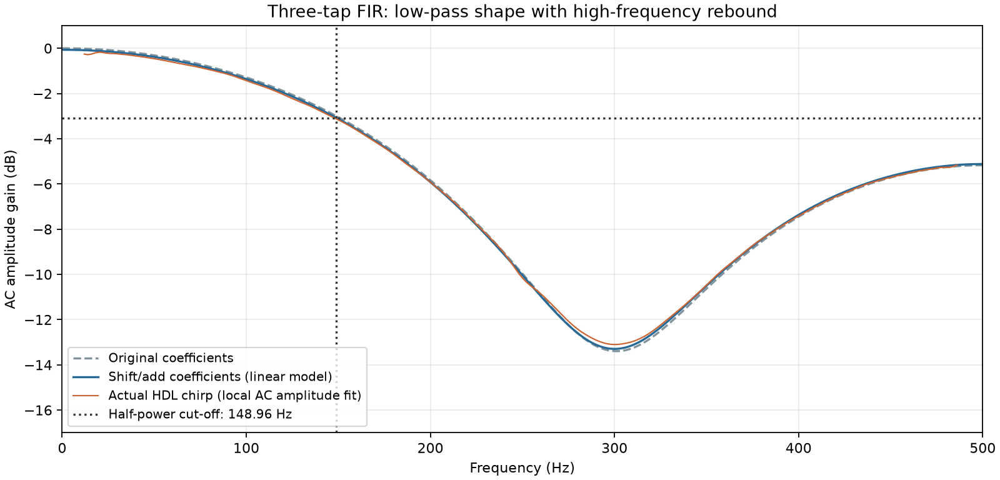

# Week 6 — Three-tap FIR Filter

Pre-work and full file-I/O lab for student **042301097**, following the [Week 6 worksheet](../../lectures/week6/week6_filter_2026.pdf), [announcement](../../lectures/week6/week6_announcement.txt), and [repository guidelines](../../AGENTS.md). The HDL uses traditional Verilog with explicit widths, named ports, continuous assignments, and synchronous clocked registers.

- **Beginner explanation:** [BEGINNER_GUIDE.md](docs/BEGINNER_GUIDE.md)
- **Detailed hardware & math walkthrough:** [WALKTHROUGH.md](docs/WALKTHROUGH.md)

| Lab section | Answer file | What it provides |
|---|---|---|
| Pre-work: coefficients | [WALKTHROUGH.md](docs/WALKTHROUGH.md#1-calculate-the-coefficients) | Exact values and three-shift approximations |
| Pre-work: constant multipliers | [cm0.v](rtl/cm0.v), [cm1.v](rtl/cm1.v) | Combinational eight-bit shift/add blocks |
| Filter (modular) | [fir_filter.v](rtl/fir_filter.v) | Two sample delays, three taps, adder, registered output |
| Filter (single-file alternative) | [fir_filter_combined.v](rtl/fir_filter_combined.v) | Same filter with constant multipliers inline |
| Chirp generation | [generate_chirp.py](scripts/generate_chirp.py), [generate_chirp.m](scripts/generate_chirp.m) | 2,000 unsigned binary samples in [X.txt](sim/X.txt) |
| File-I/O simulation | [tb_chirp.v](sim/tb_chirp.v) | Reads `X.txt`, checks each output, writes [Y.txt](sim/Y.txt) |
| Arithmetic and timing checks | [tb_fir.v](sim/tb_fir.v) | Exhaustive multiplier inputs and 4,634 filter cycles |
| Plotting and analysis | [analyze_response.py](scripts/analyze_response.py) | Verifies HDL data; generates PNG plots and [results.json](docs/results.json) |

For the single-file version, add only `rtl/fir_filter_combined.v` to your Quartus project and set the top-level entity to `fir_filter_combined`. Both testbenches compare `fir_filter` and `fir_filter_combined` cycle by cycle.

## Results for 042301097

The last two digits are 97; swapping them gives 79. Thus `A0 = 97`, `A1 = 79`, `A2 = 176`, and the denominator is 352.

| Tap | Exact coefficient | Implemented approximation | Right shifts |
|---|---|---|---|
| `a0` | `97/352 = 0.2755681818` | `35/128 = 0.2734375` | `2, 6, 7` |
| `a1` | `79/352 = 0.2244318182` | `7/32 = 0.21875` | `3, 4, 5` |
| `a2` | `176/352 = 0.5` | `0.5` | `1` |

The approximated coefficient sum is `127/128`, below unity. Each unsigned shift truncates separately; the largest hardware output is `247`, so the eight-bit output cannot overflow.

| Characteristic | Result |
|---|---|
| Filter type | Low-pass, with a shallow stop-band and high-frequency rebound |
| Coefficient-model pass-band gain | **−0.068125 dB** |
| Coefficient-model half-power cut-off | **148.958 Hz** at a 1 kHz sample rate |
| Fit to simulated integer output | Approximately **−0.143 dB**, **149.26 Hz** |
| Local chirp amplitude cut-off estimate | Approximately **149.65 Hz** |



## Quick Simulation & Analysis

From `verilog/week6/`:

```bash
# Run both Verilog testbenches (unit tests + chirp file-I/O)
make test

# Regenerate X.txt, simulate, and rebuild plots + results.json
make
```

Observed simulation output:

```text
PASS: all 256 inputs of cm0/cm1; 4634 FIR cycles, reset, impulse, bounds, and history.
PASS: combined filter matches the modular filter on every checked cycle.
PASS: 2000 chirp samples read from X.txt, checked, and written to Y.txt.
```

### ModelSim / Questa

From `verilog/week6/sim/`:

```tcl
do simulate.do
```

## Quartus and RTL Viewer

Open [fir_filter.qpf](quartus/fir_filter.qpf) in Quartus Prime 18.1, or create a project with device `5CSEMA5F31C6`, top-level entity `fir_filter`, and the three files (`cm0.v`, `cm1.v`, `fir_filter.v`) from `rtl/` (or just `fir_filter_combined.v` with top-level `fir_filter_combined`). Run **Analysis & Elaboration**, then **Tools → Netlist Viewers → RTL Viewer** to inspect the synthesized schematic.

## Folder Guide

| Folder | Contents |
|---|---|
| `rtl/` | Three modular synthesis files (`cm0.v`, `cm1.v`, `fir_filter.v`) and standalone `fir_filter_combined.v` |
| `sim/` | Testbenches (`tb_fir.v`, `tb_chirp.v`), ModelSim script, generated `X.txt` and `Y.txt` |
| `scripts/` | Chirp generation (Python & MATLAB) and frequency response analysis |
| `quartus/` | Project settings and 1 kHz clock constraint |
| `docs/` | [BEGINNER_GUIDE.md](docs/BEGINNER_GUIDE.md), [WALKTHROUGH.md](docs/WALKTHROUGH.md), [results.json](docs/results.json), diagrams, and plots |
