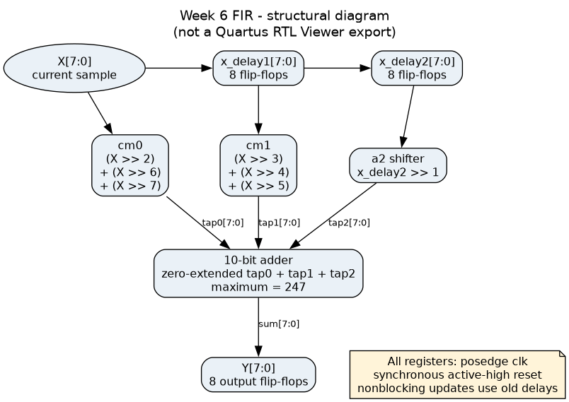
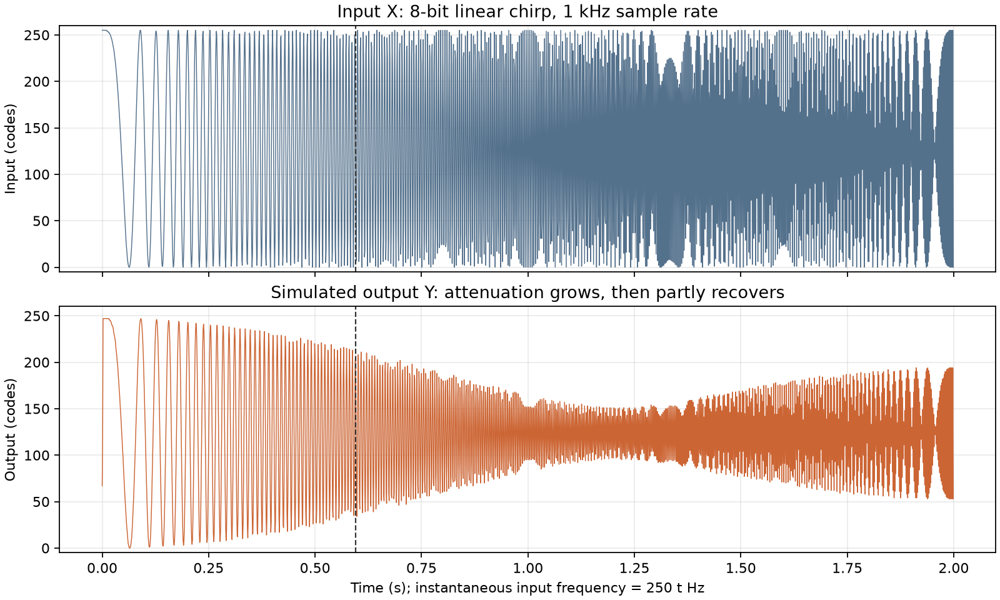
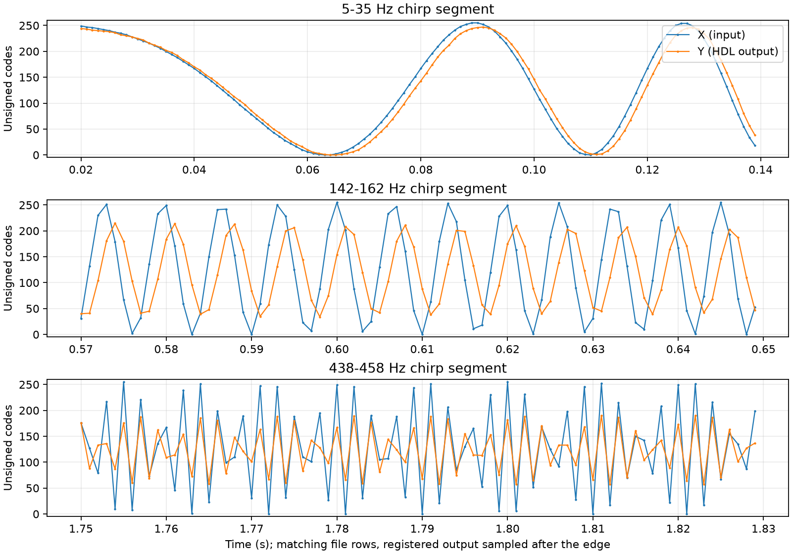

# Week 6 — FIR Filter Walkthrough

Worked solution to the [Week 6 filter worksheet](../../../lectures/week6/week6_filter_2026.pdf) for student **042301097**. The design targets the course's DE1-SoC / Quartus Prime 18.1 workflow and follows [AGENTS.md](../../../AGENTS.md).

The worksheet asks for a three-tap filter:

```text
y[n] = a0*x[n] + a1*x[n-1] + a2*x[n-2]
```

A tap is one weighted sample. The circuit remembers two earlier inputs, scales the current and earlier samples, then adds the three results. Its output also has a register, so a testbench can capture a complete result after each rising edge.

For a single-file alternative, use [fir_filter_combined.v](../rtl/fir_filter_combined.v). It replaces the `cm0` and `cm1` instances with their shift-and-add expressions inside the filter. Everything else, including the two sample delays, per-shift truncation, synchronous reset, and registered Y timing, is the same. Compile only that file and select `fir_filter_combined` as the top-level entity. Both testbenches check that it matches the modular filter.

| Step | Main file | Hardware or lab task |
|---|---|---|
| 1 | This calculation | Find the three coefficients |
| 2 | [cm0.v](../rtl/cm0.v), [cm1.v](../rtl/cm1.v) | Scale samples using fixed shifts and adders |
| 3 | [fir_filter.v](../rtl/fir_filter.v) | Connect sample registers, taps and output |
| 4 | [generate_chirp.py](../scripts/generate_chirp.py) | Generate the quantized input file |
| 5 | [tb_chirp.v](../sim/tb_chirp.v) | Read X, clock the circuit, write Y |
| 6 | [analyze_response.py](../scripts/analyze_response.py) | Verify and interpret the simulated response |

## 1. Calculate the coefficients

Use the last **two** digits, including their order:

```text
Student number = 042301097
Last two digits = 97
Swapped digits = 79

A0 = 97
A1 = 79
A2 = A0 + A1 = 176
Denominator = A0 + A1 + A2 = 352

a0 = 97/352  = 0.2755681818...
a1 = 79/352  = 0.2244318182...
a2 = 176/352 = 0.5
```

The exact coefficients add to one. This gives unity DC gain before quantization. The third coefficient is always one-half under the worksheet's rule because `A2 = A0 + A1` and the denominator is `2*A2`.

We cannot store an arbitrary real coefficient in an ordinary eight-bit sample wire. For this exercise, approximate each coefficient by at most three reciprocal powers of two. A positive-term choice makes the arithmetic simple and keeps the sum below unity:

| Tap | Approximation | Decimal | Approximation minus exact value |
|---|---|---|---|
| a0 | 1/4 + 1/64 + 1/128 = 35/128 | 0.2734375 | −0.0021306818 |
| a1 | 1/8 + 1/16 + 1/32 = 28/128 | 0.21875 | −0.0056818182 |
| a2 | 1/2 = 64/128 | 0.5 | 0 |

For a0, start at 1/4 and use 1/64 and 1/128 to approach the remainder. For a1, use 1/8, then 1/16 and 1/32. These are straightforward three-positive-term approximations; they do not claim to optimize every possible add/subtract circuit.

```text
Approximated sum = (35 + 28 + 64)/128 = 127/128 = 0.9921875
```

The sum is smaller than one, satisfying the worksheet's gain restriction.

## 2. Build cm0 and cm1

For an unsigned integer, shifting right by `s` bits calculates `floor(X / 2^s)`. Zero bits enter from the left and the lowest `s` bits are discarded. There is no fractional part on an eight-bit integer wire.

For example, `7 >> 1` gives 3. The missing half is a quantization error. An unsigned declaration is important: the input codes 128 through 255 must remain positive.

### cm0: approximate multiplication by 97/352

The important line in [cm0.v](../rtl/cm0.v) is:

```verilog
assign Z = (X >> 3'd2) + (X >> 3'd6) + (X >> 3'd7);
```

The three expressions are parallel wires carrying `floor(X/4)`, `floor(X/64)`, and `floor(X/128)`. Two additions combine them. Both the input and output are declared `[7:0]`. For `X = 128`, the terms are `32 + 2 + 1`, giving 35.

The `3'd2` notation means a three-bit decimal constant with value 2. It specifies how many positions to shift; it does not set the sample width.

### cm1: approximate multiplication by 79/352

The important line in [cm1.v](../rtl/cm1.v) is:

```verilog
assign Z = (X >> 3'd3) + (X >> 3'd4) + (X >> 3'd5);
```

For `X = 128`, this gives `16 + 8 + 4 = 28`. It also uses exactly three shifts and two additions.

These blocks have no `clk`, no `reset`, and no `always` block. They are combinational circuits. A constant shift rearranges bit connections; it is not a sample-delay register. The lecture sometimes uses “shift register” loosely when discussing these multipliers, but storage is only needed for the sample history and registered output here.

### Why the fractional model and hardware differ

Each shift truncates before its result is added. Thus cm0 implements:

```text
floor(X/4) + floor(X/64) + floor(X/128)
```

This need not equal `floor(35*X/128)`. At `X = 255`, cm0 gives `63 + 3 + 1 = 67`, whereas `floor(35*255/128) = 69`. Both the simulation reference and the analysis account for the actual per-term truncation.

## 3. Connect the filter



The [zoomable SVG](diagrams/fir_filter.svg) and [Graphviz source](diagrams/source/fir_filter.dot) show the same circuit. This is a structural drawing derived from the source; use Quartus RTL Viewer to obtain the tool-generated schematic requested for submission.

The filter interface is:

| Port | Width | Meaning |
|---|---|---|
| `X` | 8 | Unsigned current sample, 0–255 |
| `clk` | 1 | Sample on its rising edge |
| `reset` | 1 | Active-high synchronous reset |
| `Y` | 8 | Registered unsigned filter result |

The delay chain uses two eight-bit registers:

```verilog
reg [7:0] x_delay1;
reg [7:0] x_delay2;
```

Before a sample edge, they hold `x[n-1]` and `x[n-2]`. The three weighted signals are connected with named ports and continuous assignments:

```verilog
cm0 multiplier0 (.X(X), .Z(tap0));
cm1 multiplier1 (.X(x_delay1), .Z(tap1));

assign tap2 = x_delay2 >> 3'd1;
assign sum = {2'b00, tap0} + {2'b00, tap1} + {2'b00, tap2};
```

`{2'b00, tap0}` concatenates two zero bits with the eight-bit tap. This makes every adder operand ten bits wide. A sum of three arbitrary eight-bit values could reach 765, requiring ten bits. Our tap coefficients give a smaller proven bound:

```text
max tap0 = 255/4 + 255/64 + 255/128, each truncated = 63 + 3 + 1 = 67
max tap1 = 255/8 + 255/16 + 255/32, each truncated = 31 + 15 + 7 = 53
max tap2 = floor(255/2) = 127
max sum  = 67 + 53 + 127 = 247
```

All three tap functions increase or stay unchanged as their input increases, so checking their maximum inputs establishes the bound for every possible history. The upper two sum bits are always zero for valid binary samples. Taking `sum[7:0]` does not wrap or saturate the output.

The clocked portion of [fir_filter.v](../rtl/fir_filter.v) is:

```verilog
always @(posedge clk) begin
    if (reset) begin
        x_delay1 <= 8'd0;
        x_delay2 <= 8'd0;
        Y <= 8'd0;
    end else begin
        x_delay1 <= X;
        x_delay2 <= x_delay1;
        Y <= sum[7:0];
    end
end
```

The nonblocking assignments use the old register values on their right-hand sides. `x_delay2` receives the old `x_delay1`, while Y receives the sum of the current input and both old delay values. The history advances at the same edge. This is 24 stored bits in total: 16 for history and 8 for Y.

Reset is checked before normal sampling, so reset wins. It has an effect only on a rising edge. Changing X or asserting reset between edges does not immediately change Y. The input should be stable before the edge; read Y after nonblocking assignments settle.

An impulse provides an easy timing check:

| Edge | Reset | Input X | Previous x_delay1 | Previous x_delay2 | Y after edge |
|---|---|---|---|---|---|
| Reset | 1 | any | any | any | 0 |
| n = 0 | 0 | 128 | 0 | 0 | 35 |
| n = 1 | 0 | 0 | 128 | 0 | 28 |
| n = 2 | 0 | 0 | 0 | 128 | 64 |
| n = 3 | 0 | 0 | 0 | 0 | 0 |

Y is registered once; there is no additional output register after Y. File row n contains the result for input row n, including the two earlier rows.

## 4. Generate the chirp

The lab specifies `fs = 1000 Hz`, a two-second record, and a linear frequency sweep through 250 Hz at one second:

```text
t[n] = n/1000, n = 0,...,1999
f(t) = 250*t Hz
phase(t) = 2*pi*integral(f(t) dt) = 250*pi*t^2
signal(t) = cos(250*pi*t^2)
```

Integrating the instantaneous frequency matters. Using `cos(2*pi*f(t)*t)` would double the intended sweep rate. This cosine starts at +1, matching MATLAB's default chirp phase.

The samples cover `0 <= t < 2 s`. The last sample is at 1.999 s and has instantaneous frequency 499.75 Hz, just below the 500 Hz Nyquist limit. Excluding the endpoint gives exactly 2,000 samples rather than 2,001.

Map the bipolar signal to unsigned codes and round to the nearest integer:

```text
mapped[n] = 127.5 * (signal[n] + 1)
X[n] = floor(mapped[n] + 0.5), limited to 0...255
```

Therefore −1 maps to 0, 0 maps to 128 after rounding, and +1 maps to 255. [generate_chirp.py](../scripts/generate_chirp.py) uses this explicit rounding rule, rather than Python's round-to-even rule. It writes one eight-character binary value per line to [X.txt](../sim/X.txt). There are no prefixes, spaces, or timestamps.

From `verilog/week6/`:

```bash
python3 scripts/generate_chirp.py
```

The [MATLAB equivalent](../scripts/generate_chirp.m) uses `chirp(t, 0, 1, 250, 'linear', 0)` and the same time vector and mapping. It is supplied for the lab workflow but was not run here. At rounding boundaries, floating-point implementations can produce a one-code difference; the supplied files and strict Python analysis use the Python generator as their reproducible reference.

## 5. Read X.txt and record Y.txt

[tb_chirp.v](../sim/tb_chirp.v) instantiates `fir_filter` using named ports and generates a free-running clock. Its `timescale` is `1ns/1ps`, so:

```verilog
always #500000 clk = ~clk;
```

produces a 1 ms period, corresponding to the 1 kHz sample rate. The filter itself contains no delays; its numerical response depends on the sequence of samples.

The file operations are:

```verilog
input_file = $fopen("X.txt", "r");
output_file = $fopen("Y.txt", "w");
read_status = $fscanf(input_file, "%b", binary_sample);
...
$fwrite(output_file, "%08b\n", Y);
```

`%b` reads binary, and `%08b` writes all eight output bits, including leading zeros. Both files are unsigned binary. Open failures, invalid values, unexpected file length, and arithmetic mismatches stop the simulation with `$fatal`. The analysis additionally checks that every line contains exactly eight binary digits.

The capture order avoids races:

1. Clock reset once; do not write a reset result to Y.txt.
2. Read one input word and drive it at the falling edge.
3. Compute an integer reference from the current sample and two previous samples.
4. Wait for the next rising edge, then `#1` for the nonblocking assignments.
5. Check Y and write it to Y.txt.
6. Repeat until end-of-file, then close both files.

The reference uses integer divisions by 4, 64, 128, 8, 16, 32, and 2, independently of the RTL shift syntax. There is no output normalization or compensating gain. Y.txt contains exactly 2,000 rows. The two possible convolution-tail samples are intentionally omitted so that rows line up with X.txt. The first two outputs include zero-filled prehistory, not a steady-state assumption.

Use `make simulate` from `verilog/week6/`, or `do simulate.do` from `sim/` in ModelSim. Relative file paths in `$fopen` resolve against the simulator's working directory, which must be `sim/`.

## 6. Visualize and analyze the actual output

Run [analyze_response.py](../scripts/analyze_response.py) after the HDL simulation. It reads both binary files, verifies their format and length, compares X to the specified chirp, and checks every Y against the integer reference. It fails on missing, malformed, stale, or incorrectly aligned data. It never replaces Y with a software-generated result.



The early chirp oscillations pass with nearly their original AC amplitude. Later oscillations shrink. The smallest envelope appears near 300 Hz; at still higher frequencies, some amplitude returns. The first samples show the expected start-up transient because the delay chain begins at zero.



These overlays show the real unsigned input and output codes in three time windows. Phase delay explains why their peaks do not line up exactly. The output baseline also shifts slightly downward because the coefficient sum is below one and the seven right shifts discard fractional bits.

### Filter type


This is a **low-pass** response: DC has the largest gain, and the first cut-off is near 149 Hz. It is a short filter with limited rejection, not a sharp ideal low-pass. Its nominal minimum is approximately −13.29 dB near 300.1 Hz, followed by a rebound to −5.12 dB at 500 Hz. The rebound remains below the half-power threshold.

The coefficients are not symmetric (`a0 != a2`), so the filter is not an exactly linear-phase symmetric FIR. Three taps do not automatically make a linear-phase filter.

### Pass-band gain in dB

For the approximated coefficients before integer truncation:

```text
H(z) = 35/128 + (28/128)*z^-1 + (64/128)*z^-2
H(1) = 127/128 = 0.9921875
Gpass = 20*log10(127/128) = -0.0681249738 dB
```

The pass-band reference is the low-frequency/DC limit; gain gradually decreases as frequency rises. With equal impedances, power gain is `10*log10(Pout/Pin)`, and an amplitude ratio uses `20*log10(Aout/Ain)` because power is proportional to amplitude squared.

Do not use raw unsigned RMS values as AC gain. X includes a 127.5-code DC offset, and the output also contains DC. The analysis fits an offset separately from the oscillating signal and permits a phase shift.

For the actual integer output, it fits:

```text
Y[n] approximately b0*X[n] + b1*X[n-1] + b2*X[n-2] + constant
```

over rows n = 2,...,1999. This gives a best linear approximation to the nonlinear quantized circuit, with pass-band gain about **−0.143 dB**, cut-off about **149.26 Hz**, and residual RMS about **0.932 code**. These measured values depend on the input and quantization; they are not a second exact transfer function.

At constant full-scale input, Y settles at 247. `20*log10(247/255)` is the ratio of those DC codes; it includes truncation effects and should not replace the nominal coefficient-model AC gain.

### Cut-off frequency

The conventional −3 dB cut-off is the first frequency where power is half its pass-band value:

```text
|H(fc)| / |H(0)| = 1/sqrt(2) = 0.70710678...
10*log10(1/2) = -3.01029996 dB
```

The worksheet's description of half **amplitude** at −3 dB is incorrect: half amplitude would be approximately −6.02 dB. Here “−3 dB” uses the usual half-power convention; a literal −3.000 dB threshold would be slightly different.

With `omega = 2*pi*f/1000` and coefficients `b0`, `b1`, `b2`:

```text
|H(f)|^2 = b0^2 + b1^2 + b2^2
           + 2*b1*(b0+b2)*cos(omega)
           + 2*b0*b2*cos(2*omega)
```

The script finds the first half-power crossing numerically:

| Analysis | Cut-off |
|---|---|
| Original exact coefficients | 149.166 Hz |
| Selected shift/add coefficient model | **148.958 Hz** |
| Three-tap fit to actual HDL data | **149.26 Hz** |
| Local chirp AC-amplitude measurement | **149.65 Hz**, approximately |

The last measurement uses 96-sample Hann-weighted windows, spaced eight samples apart. In each window it fits cosine, sine, and a constant at the known chirp phase. The sine/cosine amplitude permits phase delay; the constant separates the offset. It compares the output and input fitted amplitudes and interpolates their first half-power crossing relative to the fitted pass-band gain. Window width, the changing frequency, and integer truncation limit its precision.

The nominal cut-off occurs at `t = 148.958/250`, or about **0.596 s**, marked on the full time plot. The simulated data supports a practical cut-off near **150 Hz**.

### Quantization and numeric checks

The actual hardware equation is:

```text
y[n] = floor(x[n]/4) + floor(x[n]/64) + floor(x[n]/128)
     + floor(x[n-1]/8) + floor(x[n-1]/16) + floor(x[n-1]/32)
     + floor(x[n-2]/2)
```

There are seven truncating terms. The total error relative to the fractional coefficient model is nonpositive and less than seven codes in magnitude. In this chirp, the mean error after start-up is approximately −3.017 codes and the largest magnitude is approximately 6.008 codes. This is quantization error relative to the linear model; **the bit-accurate HDL/reference error is zero for all 2,000 rows**.

All numeric results are saved in [results.json](results.json), and each plot is saved as a PNG in `docs/plots/`.

## 7. Simulation and Quartus

From `verilog/week6/`, run the testbenches or the full analysis flow:

```bash
make test
make
```

The [unit testbench](../sim/tb_fir.v) exhaustively tests both multipliers' 256 possible input values and checks 4,634 filter cycles across both `fir_filter` and `fir_filter_combined`: reset, impulse history, a ramp, maximum inputs, alternating extremes, reset of a populated delay chain, and deterministic pseudo-random inputs.

For Quartus:

1. Open [fir_filter.qpf](../quartus/fir_filter.qpf), or create a project for `5CSEMA5F31C6` with top-level `fir_filter` (or `fir_filter_combined`).
2. Include `rtl/cm0.v`, `rtl/cm1.v`, and `rtl/fir_filter.v` (or `rtl/fir_filter_combined.v`). Do not add the testbenches as synthesis files.
3. Run Analysis & Elaboration, then open **Tools → Netlist Viewers → RTL Viewer** to inspect the schematic.
